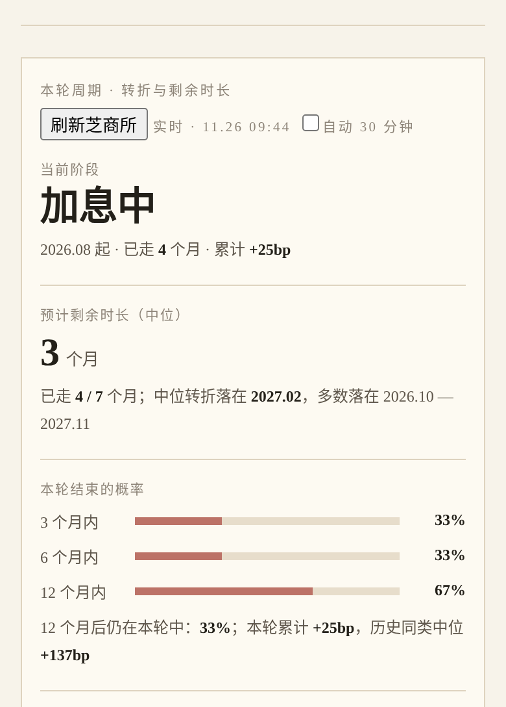
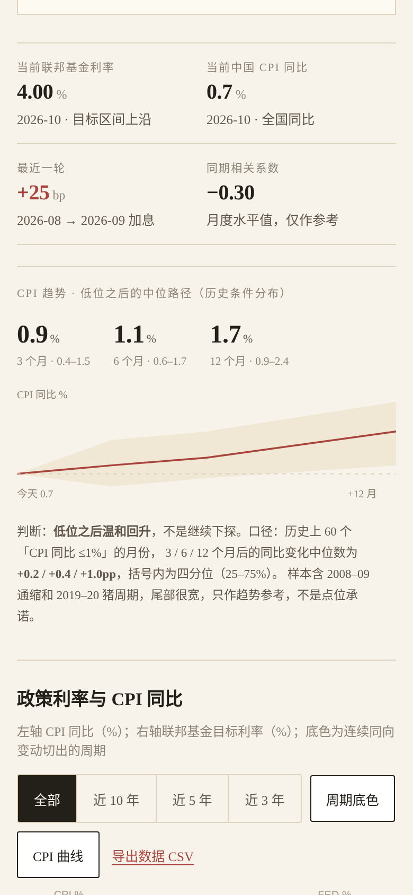

# 美联储加降息周期 × 中国 CPI

一个安卓小工具：把「美联储政策利率处在加/降息的哪个阶段」「下次 FOMC 往哪边走」「中国 CPI 往下怎么走」三件事放在一屏里，随手可查。

- 单 Activity + WebView，页面自包含，**不依赖 Gradle**（aapt2 + javac + d8 + zipalign + apksigner 直接出 APK）
- 无后端、无账号，数据要么内置、要么直连公开接口

<p align="center">
  
  
</p>

## 直接安装

- 最新安装包：[`dist/fed-cycle-cpi-v1.8.apk`](dist/fed-cycle-cpi-v1.8.apk)（394 KB，minSdk 24 / targetSdk 30，自签名）
- 手机浏览器打开上面的链接下载，点安装，未知来源允许一次即可
- 自签名包，换机或跨版本覆盖装不上时先卸载旧版

## 它回答什么

| 卡片 | 内容 | 方法 |
| --- | --- | --- |
| 周期面板 | 本轮起点、已走几个月、累计 bp、剩余时长中位数、3/6/12 个月内结束概率 | 1982 年以来同类周期的经验生存模型（条件存活率） |
| 会议方向 | 下次 FOMC 加息 / 不变 / 降息概率，及距会议天数 | Polymarket 公开市场价（**非芝商所**，通常与 CME 差 1–5pp） |
| CPI 趋势 | 当前同比 + 未来 3/6/12 个月中位路径与四分位区间 | 历史上所有「CPI ≤ 1%」月份之后的变化分位 |
| 双轴曲线 | 政策利率 vs CPI 同比，2008-01 至今，按同向变动切出周期底色 | 内置 data.json |

## 数据来源与口径

| 数据 | 来源 | 频率 | 说明 |
| --- | --- | --- | --- |
| 中国 CPI 同比 | 国家统计局，经 AkShare `macro_china_cpi` | 月度 | 全国同比，单位 % |
| 联邦基金目标利率 | FRED `DFEDTARU`（目标区间上沿），早期补 `DFEDTAR` | 事件驱动 | 台阶函数，取月末值 |
| 会议方向概率 | `gamma-api.polymarket.com` 公开接口 | 手动刷新 | 页面明确标注来源，失败时保留上次成功值 |
| 周期/趋势统计 | 本地计算（见 `pipeline/`） | 随数据更新 | 样本量小，只作分布参考 |

> 芝商所 FedWatch 的旧公开接口 `/CmeWS/mvc/MktData/FedWatch.json` 已下线（返回 404），官方新接口需订阅 key，因此本应用不抓芝商所，方向改由预测市场读取。

## 构建

需要 JDK 17、Android SDK（build-tools 34.0.0、platform android-35）。

```bash
cd android
./build.sh          # 产物在同级目录 美联储周期.apk
```

可用环境变量覆盖默认路径：

```bash
ANDROID_SDK=/path/to/sdk JDK_HOME=/path/to/jdk ./build.sh
```

签名用本地自签 debug key，仓库不包含 `.keystore`（缺失时脚本自动生成），所以 clone 后重新构建的 APK 需要覆盖安装旧版本时会有签名冲突，卸载重装即可。

## 更新数据

```bash
cd pipeline
pip install akshare pandas
python 抓数据.py       # 重算 data.json / payload.json（需要 DFEDTAR*.csv 与联网）
python 周期预测.py     # 重算 pred.json
```

更新后把 `data.json`、`pred.json` 的内容写回 `android/assets/index.html` 里的数据块，再重新构建。

## 目录

```
android/                安卓工程（AndroidManifest.xml、src、res、assets、build.sh）
android/assets/         index.html（页面）、echarts.min.js（离线图表库）
pipeline/               数据抓取与模型脚本 + 序列数据
docs/                   README 截图
```

## 已知限制

- 方向概率依赖 Polymarket 可达性；网络不通时显示快照值并标注「刷新失败」。
- 周期模型是经验分布，不是因果推断；趋势预测是条件分位，尾部很宽（样本里含 2008–09 通缩与 2019–20 猪周期）。
- 均为月度/事件级数据，不做日内更新。

**不构成任何投资建议。**

## License

MIT，见 `LICENSE`。
